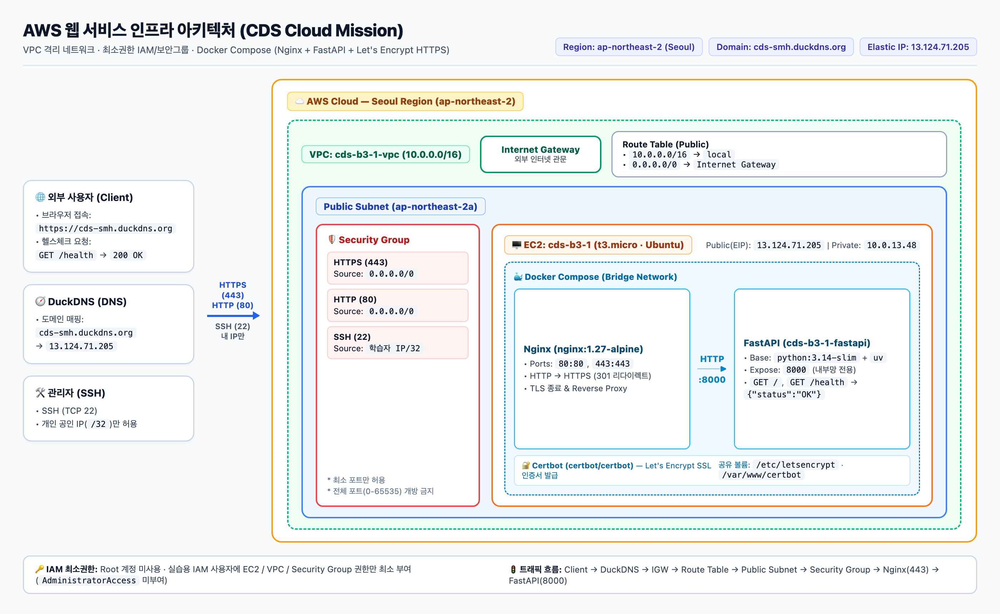
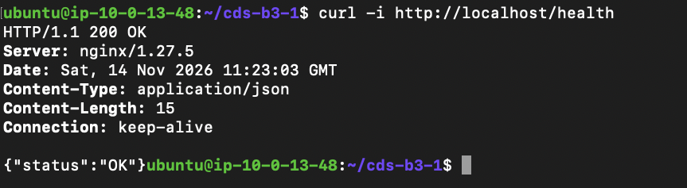
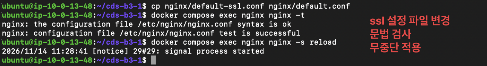

# AWS 웹 서비스 인프라 구축 및 배포 (CDS Cloud Mission)

AWS 서울 리전(`ap-northeast-2`)에 VPC 격리 네트워크와 최소권한 IAM·보안 그룹을 직접 설계하고, **Docker Compose(Nginx + FastAPI + Let's Encrypt HTTPS)** 기반 웹 서비스를 배포·운영·정리한 프로젝트입니다.

---

## 1. 아키텍처 다이어그램



- **트래픽 흐름**: `외부 사용자 (HTTPS 443 / HTTP 80)` → `DuckDNS (cds-smh.duckdns.org)` → `Internet Gateway` → `Route Table (0.0.0.0/0 → IGW)` → `Public Subnet` → `Security Group` → `EC2 (Nginx 컨테이너)` → `FastAPI 컨테이너 (8000)`

---

## 2. 인프라 및 보안 구성 요약

| 구분 | 구성 내용 |
| :--- | :--- |
| **리전** | `ap-northeast-2` (서울) |
| **IAM** | Root 계정 미사용 · 실습용 IAM 사용자에 EC2 / VPC / Security Group 권한만 최소 부여 |
| **네트워크** | VPC `cds-b3-1-vpc` (`10.0.0.0/16`), Public Subnet (`ap-northeast-2a`), Internet Gateway, Route Table (`0.0.0.0/0 → IGW`) |
| **컴퓨트** | EC2 `cds-b3-1` (`t3.micro`, Ubuntu, Elastic IP `13.124.71.205`) |
| **보안 그룹** | Inbound: `HTTPS(443)` `0.0.0.0/0`, `HTTP(80)` `0.0.0.0/0`, `SSH(22)` `학습자 공인 IP/32` |

---

## 3. 외부 접속 검증 (필수 과제 & 보너스 1: HTTPS)

- **선택한 검증 방식**: **(A) 브라우저 접속** + **(B) 헬스체크(`/health`) 병행 검증**
- **접속 주소**:
  - 도메인 (HTTPS): `https://cds-smh.duckdns.org`
  - 헬스체크: `https://cds-smh.duckdns.org/health` (내부 `http://localhost/health` 포함)
  - 퍼블릭 IP (Elastic IP): `13.124.71.205`
- **HTTPS 적용 방식 (보너스 1)**:
  - DuckDNS 무료 서브도메인(`cds-smh.duckdns.org`)을 Elastic IP(`13.124.71.205`)에 연결
  - `certbot/certbot` 컨테이너(`--webroot`)로 Let's Encrypt SSL 인증서 발급
  - Nginx에서 HTTP(`80`) 요청을 HTTPS(`443`)로 `301` 리다이렉트 및 TLS 종료 처리

### 검증 스크린샷

- **EC2 내부 `http://localhost` & `http://localhost/health` (`200 OK`)**
  

- **외부 브라우저 HTTPS 접속 결과 (`https://cds-smh.duckdns.org`)**
  

---

## 4. Docker 컨테이너 구성 (보너스 2)

| 서비스 | 이미지 / 빌드 | 포트 매핑 | 역할 |
| :--- | :--- | :--- | :--- |
| `fastapi` (`cds-b3-1-fastapi-1`) | `./Dockerfile` (`python:3.14-slim` + `uv`) | `expose: 8000` (내부망 전용) | FastAPI 웹 서버 (`GET /`, `GET /health` → `{"status":"OK"}`) |
| `nginx` (`cds-b3-1-nginx-1`) | `nginx:1.27-alpine` | `80:80`, `443:443` | TLS 종료, HTTP→HTTPS 리다이렉트, `http://fastapi:8000` 리버스 프록시 |
| `certbot` | `certbot/certbot` (`profiles: ["certbot"]`) | - | Let's Encrypt 인증서 발급/갱신 (`/etc/letsencrypt`, `/var/www/certbot` 볼륨 공유) |

- **실행 방식**:
  ```bash
  # 1) HTTP 모드로 컨테이너 빌드 및 실행
  docker compose up -d --build

  # 2) Let's Encrypt SSL 인증서 발급
  docker compose run --rm certbot certonly \
    --webroot --webroot-path=/var/www/certbot \
    --email <email> --agree-tos --no-eff-email \
    -d cds-smh.duckdns.org

  # 3) HTTPS 설정 적용 및 무중단 리로드
  cp nginx/default-ssl.conf nginx/default.conf
  docker compose exec nginx nginx -t
  docker compose exec nginx nginx -s reload
  ```

- **컨테이너 실행 상태 (`docker ps`)**
  

- **SSL 인증서 발급 및 Nginx 리로드**
  

---

## 5. 문서 및 증빙 목록

- 아키텍처 다이어그램: [docs/architecture.png](docs/architecture.png)
- 트러블슈팅 보고서: [docs/troubleshooting.md](docs/troubleshooting.md)
- 리소스 정리 체크리스트: [docs/cleanup-checklist.md](docs/cleanup-checklist.md)
- 단계별 전체 스크린샷: [docs/screenshots/](docs/screenshots/) (`1-region` ~ `8-end`)
